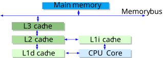

---
hide:
  - toc
---

# `libsoa`

[](https://github.com/quasar-chunawala/qc-soa/actions/workflows/linux.yml)
[](https://github.com/quasar-chunawala/qc-soa/actions/workflows/macos.yml)
[](https://github.com/quasar-chunawala/qc-soa/actions/workflows/windows.yml)

`libsoa` is a library of SoA(Structure-Of-Arrays) containers. It is a header-only **C++26** library that stores a sequence of aggregates in a **Structure-of-Arrays (SoA)** fashion, while having a container interface similar to STL. It uses static reflections to do this.

## Introduction

On paper, a $O(1)$ algorithm runs faster than a $O(n)$ algorithm. Even if you ran the $O(n)$ algorithm on a super-computer and the $O(1)$ algorithm on a digital watch, we have a theoretical guarantee that the $O(1)$ algorithm beats the $O(n)$ algorithm. Everybody loves a guarantee! It is independent of hardware constants. 

In practice, however, an algorithm with prettier Big-$O$ can lose to a simpler layout if it pointer chases through cold memory. 

## Cache behavior is often more important than Big-$O$ notation

Modern CPUs are extremely fast at data already in registers or nearby cache. 

Usually, when we are writing something like `a += b`; it is a register-register (R-R) operation, so the data has to go from the registers to the ALU and back. However, all modern 64-bit CPUs are actually pipelined, so by the time the ALU actually needs this information, it is altready at the CPU entrance, so we can avoid the latency penalty of going from registers to ALU and back. 

In the 80s, the frequency of the CPU core was at a level equivalent to that of the memory bus. Memory access was only a bit slower than register access. Since then, the speeds of CPUs have grown by $3$ orders of magnitude, while memory latency has improved only $10-30$ fold or so. To deal with the remaining $30$x+ discrepancy, all kinds of caches were introduced. As a result, the speed of memory access depends significantly on the answer to - *where does the data we're trying to read, reside?*. The lower the cache level where your request was found - the faster you can get it. 

<figure markdown="span">
  { width="600" }
  <figcaption>The memory hierarchy of a single CPU core.</figcaption>
</figure>


L1 and L2 cache access times can be found in official documents such as the [Intel® 64 and IA-32 Architectures Optimization Reference Manual](http://www.intel.co.uk/content/dam/www/public/us/en/documents/manuals/64-ia-32-architectures-optimization-manual.pdf). 

| Memory type       | Access time (CPU cycles)           |
|-------------------|------------------------------------|
| L1 cache          | $4$                                |
| L2 cache          | $12$                               |
| L3 cache          | $75$                               |
| Main memory (RAM) | $\sim 180(\approx 60\text{ns})$    |

However, what is more difficult to find is information about main memory(RAM) access times. [Levinthal](https://www.intel.com/content/www/us/en/404.html?ref=https://software.intel.com/sites/products/collateral/hpc/vtune/performance_analysis_guide.pdf) lists it at $60$ns ($~180$ cycles).

Only process shrinking (going from $60$nm to $10$nm) can further improve those numbers. But, there physical limitations to that. 

When the processor recognizes that an operand being read from memory is cacheable, the processor reads an entire **cache line**($64$ bytes on modern CPUs) into the appropriate cache (L1, L2, L3, or all). This operation is called a cache line fill. If the memory location containing that operand is still cached the next time the processor attempts to access the operand, the processor can read the operand from the cache instead of going back to memory. This operation is called a cache hit. 

When the processor attempts to write an operand to a cacheable area of memory, it first checks if a cache line for that memory location exists in the cache. If a valid cache line does exist, the processor (depending on the write policy currently in force) can write the operand into the cache instead of writing it out to system memory. This operation is called a write hit. If a write misses the cache (that is, a valid cache line is not present for area of memory being written to), the processor performs a cache line fill, write allocation. Then it writes the operand into
the cache line and (depending on the write policy currently in force) can also write it out to memory. If the operand is to be written out to memory, it is written first into the store buffer, and then written from the store buffer to memory when the system bus is available.

Consider an array of prices and quantities:

```cpp
struct Level{
  std::int64_t price_ticks;   // 8 bytes
  std::int64_t quantity;      // 8 bytes
};

// Contigous price-level array
std::array<Level, 256> price_level;
```

This is contigous. When user-code is processing the $i$-th array element, `price_level[i]`, since `sizeof(Level) == 16`, the CPU would have likely fetched an entire cache line of $64$ bytes consisting of nearby array elements. Hence, they are likely to be found in the L1/L2/L3 cache. Traversing contigous data-structures is cache-friendly.

On the other-hand, consider a node-based data-structure such as `std::map`. The heap nodes are scattered in memory, and at each step, accessing a node's `next` pointer can result in a cache miss. 

## Structure-of-Arrays versus Array-of-Structures

Particles are at the heart of many astrophysical, environmental and industrial phenomena ranging from dynamics of galaxies, sandstorms, to combustion in diesel engines. $N$-body simulations in cosmology, turbulence problems in hydrodynamics etc. require numerical integration of the underlying equations of motion over many time-steps. Similarly, in a game-engine, imagine a scene where a rocket flies through the air, leaving behind a smoke trail. Suddenly, the rocket explodes leaving sparks flying everywhere. A `Particle` system is commonly used in these domains. 

```cpp
// 64 bytes
struct Particle{
  float lifetime_;  // 4 bytes, 4 bytes padding  
  Vec3 position_;   // 24 bytes
  Vec3 velocity_;   // 24 bytes
  uint32_t color_;  // 4 bytes, 4 bytes padding
};

std::vector<Particle> particleSystem;
```

In the financial markets, a participant often receives bid-ask quotes from an exchange. 

```cpp
struct Quote {
    std::int64_t price_ticks;
    std::int32_t quantity;
    std::uint32_t venue_id;
};

std::array<Quote, 1024> quotes;
```

The is an **Array-of-Structs(AoS)** layout. AoS layout keeps each complete `Particle` object contiguous, which is convenient and can be efficient during iteration when a one pass needs the whole object. 

Many of these problems only scan one field such as `velocity_` over many `Particle` records. Consider, an update loop, which reads only position and velocity. Cache lines fetched while traversing the vector may also contain `color_`, `lifetime_`, and padding that the loop does not use.

```cpp
void update_positions(std::vector<Particle>& particles, float dt){
  for(auto& particle : particles){
    particle.position_ += particle.velocity_ * dt;
  }
}
```

Thus, the loop is wasteful. For particle systems, ECS components, and vertex processing, grouping the same fields across many objects can better match a hot loop’s access pattern.

A trading strategy may only scan one field `price_` to determine the best price.  

### Data Oriented Design Philosophy

According to Data-Oriented-Design(DoD) principles, *the purpose of all programs and all parts of those programs, is to transform data from one form to another*. If you don't understand the data, you don't understand the problem. 

Data oriented design is all about reorganizing your data-structures around for better performance. Andrew Kelley’s talk on the topic—especially his use of Zig’s `MultiArrayList` — offers a compelling real-world example.

### Structure-of-Arrays(SoA) approach

```cpp
struct ParticleSystem
{
  std::vector<float> lifetimes_;
  std::vector<Vec3> positions_;
  std::vector<Vec3> velocities_;
  std::vector<uint32_t> colors_;
};
```

Positions and velocities now occupy separate, tightly traverse arrays. The update streams through the fields it needs while leaving colors and lifetimes untouched.

```cpp
struct Quotes {
    std::array<std::int64_t, 1024> price_ticks;
    std::array<std::int32_t, 1024> quantities;
    std::array<std::uint32_t, 1024> venue_ids;
};
```

If you only need prices, structure-of-arrays can cut unnecessary memory traffic.

```cpp
std::int64_t best_price = std::numeric_limits<std::int64_t>::max();

for (const auto price : quotes.price_ticks) {
    if (price < best_price) {
        best_price = price;
    }
}
```

## Computer hardware today

### SRAM versus DRAM

The static qualifier differentiates SRAM from DRAM(Dynamic Random Access Memory). In the presence of constant power, an SRAM cell maintains its state (`0` or `1`). But it is more expensive in terms of silicon area and cost. Typically, SRAM is used for the  internal registers and the cache memory of a CPU, while DRAM is used for a computer's main memory.

Dynamic RAM is in its structure, much simpler than static RAM. All it consists of is one transistor and one capacitor. 

A dynamic RAM cell keeps its state in the capacitor $\textbf{C}$. The transistor $\textbf{M}$ is used to guard access to the state. To read the state of the cell, the access line $\textbf{AL}$ is raised; this either causes a current to flow on the data line $\textbf{DL}$ or not, depending on the charge in the capacitor. 

